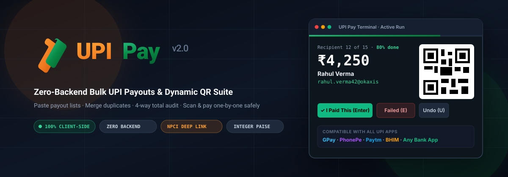
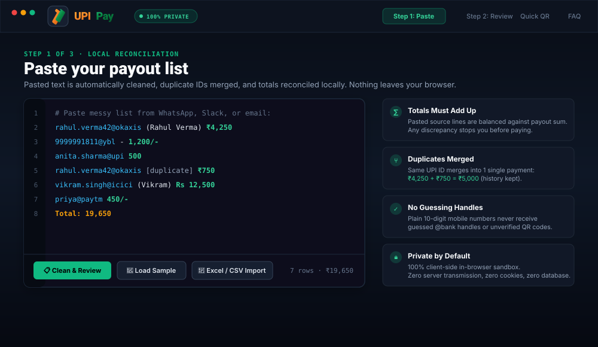
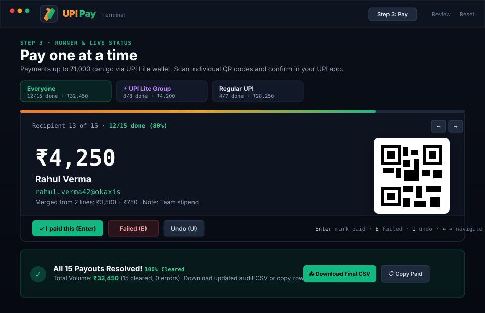
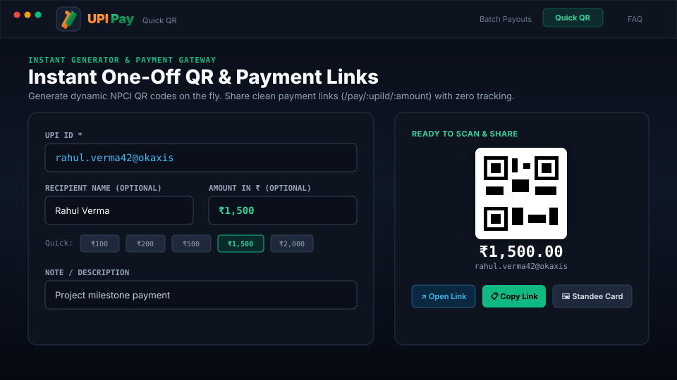
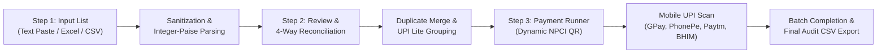

# UPI Pay — Bulk UPI, Batch Payments & Dynamic QR Suite

<p align="center">
  
</p>

<p align="center">
  <a href="https://rohitkumarranjan.in"></a>
  <a href="LICENSE"></a>
  
  
  
  <a href="https://forms.gle/eynzCQDh8v3Puosx7"></a>
</p>

---

## 📌 Overview

**UPI Pay** is an open-source, client-side web application designed to solve **bulk payouts for everyday retail bank accounts**. When you need to pay 10 to 50 people (team stipends, vendor dues, club reimbursements, tournament prizes, or event expenses), retail banking apps give you no bulk transfer API. Copy-pasting individual UPI IDs and amounts into a phone app is how costly typos and wrong-recipient transfers happen.

UPI Pay turns that chaotic process into a structured, checked, keyboard-driven workflow:
1. **Paste your messy list** or import a spreadsheet.
2. The engine **cleans it, sanitizes formulas, merges duplicate IDs, and reconciles your totals 4 ways**.
3. Scan individual NPCI-compliant QR codes one-by-one from your mobile app (**Google Pay, PhonePe, Paytm, or BHIM**) and confirm each payment on your own device.

> 🔒 **Privacy Guarantee:** 100% client-side execution. **Zero backend servers, zero database, zero cookies, and zero telemetry.** Your financial data never leaves your browser sandbox.

---

## 📸 Screenshots & Visual Walkthrough

### 1. Step 1: Messy List Paste & Automatic Cleaning
Paste raw lists copied from WhatsApp, Slack, emails, or spreadsheets. The parser extracts UPI IDs, 10-digit mobile numbers, names in brackets, and amounts like `₹1,200`, `Rs 404`, or `1634/-`.

<p align="center">
  
</p>

---

### 2. Step 3: Payment Runner with Live Progress Bar & Batch Completion
Scan dynamically generated QR codes with your favorite UPI app. Features real-time visual progress tracking and a celebratory completion dashboard with instant CSV exports.

<p align="center">
  
</p>

---

### 3. Quick QR & Shareable Payment Gateway Links
Instant one-off payment generator with quick amount presets (`₹100`, `₹200`, `₹500`, `₹1,000`, `₹2,000`), unusual handle warnings, and printable merchant standee exports.

<p align="center">
  
</p>

---

## ⚡ How It Compares

| Capability | Regular Banking Apps (GPay / PhonePe) | Corporate APIs (RazorpayX / Cashfree) | **UPI Pay (This Suite)** |
| :--- | :---: | :---: | :---: |
| **Account Type** | Retail Savings / Current | Current Account / Corporate KYC Only | **Any Savings or Current Account** |
| **API Key / Webhook Setup** | None (Manual Entry) | Complex Developer Integration | **Zero Setup (Open & Run)** |
| **Duplicate Auto-Merge** | ❌ No (Paid twice by mistake) | ❌ No | **✅ Automatic Case-Insensitive Merge** |
| **4-Way Total Reconciliation**| ❌ No (Mental math) | ⚠️ Post-transaction dashboard | **✅ Pre-Payment Math Lock** |
| **Typo Protection** | ❌ Easy to paste wrong amount | ⚠️ Relies on your backend | **✅ Integer-Paise Normalization** |
| **Data Privacy** | Provider logs all data | Cloud database logs all payees | **✅ 100% In-Browser Local Memory** |
| **Monthly Gateway Fees** | Free (Manual) | Setup fees & per-transfer cut | **✅ 100% Free & Open Source (MIT)** |

---

## 🛡️ Guarantees & Risk Mitigation

| Risk | What UPI Pay Does to Protect You |
| :--- | :--- |
| **Wrong Total / Overpaying** | **4-Way Reconciliation:** Source total vs. calculated payee total vs. declared `Total:` line. You cannot lock or start payment run if any mismatch exists unless explicitly acknowledged. |
| **Duplicate Recipients** | Same UPI ID appearing multiple times is merged into a single transfer with audit history recorded (e.g. `₹404 + ₹2,020 = ₹2,424`). Different names on the same ID trigger a warning badge. |
| **Silent Drops** | Any line the parser cannot confidently extract is placed into an **Unclear Lines** queue with the exact reason. Nothing is silently dropped. |
| **Guessed Bank Handles** | Plain 10-digit phone numbers never receive guessed handles like `@ybl` or `@paytm`. They are clearly badged as mobile transfers to pay via your app's phone lookup. |
| **Floating-Point Rounding** | All calculations run on **integer paise** (`amountPaise`). Floating-point arithmetic (`0.1 + 0.2`) is completely banned. |
| **Hidden Characters & Typos** | Zero-width spaces, full-width numerals, and non-breaking spaces are sanitized. Lookalike Cyrillic homoglyphs break regex rather than generating an erroneous VPA. |
| **Accidental Double Pay** | Paid rows disable their QR code instantly. A strict 800ms debounce cooldown prevents double `Enter` keystrokes. |
| **Formula / CSV Injection** | All exported files and clipboard outputs sanitize cells starting with `= + - @` with leading single quotes to protect Microsoft Excel and Google Sheets users. |
| **Search Engine Snooping** | Payment URLs under `/pay/` and `/#/pay/` are protected with `robots.txt Disallow` and dynamic `noindex, nofollow, noarchive` headers. |

---

## ⚙️ Workflow Architecture



---

## ⌨️ Keyboard Shortcuts (Hands-Free Run)

The Payment Runner is built for maximum speed and ergonomic flow without needing to touch a mouse:

| Key | Action | Behavior |
| :---: | :--- | :--- |
| <kbd>Enter</kbd> | **Mark Paid** | Marks active row as `paid ✅`, chimes, triggers instant toast with Undo, and advances to the next pending payee. |
| <kbd>E</kbd> | **Mark Failed / Error** | Opens the failure reason dialog (e.g., bank server down, user declined, limit hit). |
| <kbd>U</kbd> | **Undo Status** | Reverts active row back to `pending`. |
| <kbd>→</kbd> | **Next Recipient** | Skips forward without changing payment status. |
| <kbd>←</kbd> | **Previous Recipient** | Moves back to inspect previous payee. |

---

## 🏛️ Verified NPCI & RBI Transaction Limits

UPI Pay incorporates verified guidelines set by the **National Payments Corporation of India (NPCI)** and RBI:

| Transaction Type | Official NPCI / Bank Standard Limit | UPI Pay Built-In Safety Feature |
| :--- | :--- | :--- |
| **P2P Daily Velocity Cap** | **20 transactions per day** per bank account | Visual counter and progress bar to prevent hitting velocity ceilings. |
| **P2P Daily Monetary Limit** | **₹1,00,000 per 24 hours** (standard across most commercial banks) | Displays total batch volume upfront to avoid mid-run bank rejection. |
| **New UPI PIN / Device Limit** | **₹5,000 for the first 24 hours** on reset | Warns users when high payments are initiated on newly linked devices. |
| **UPI Lite (PIN-less)** | **₹1,000 per transaction**<br>**₹5,000 max wallet balance**<br>**₹10,000 daily cumulative spend** | Automatically groups payments ≤ ₹1,000 into a dedicated **UPI Lite Tab** with wallet top-up advice. |
| **High-Value Transfers** | Standard bank vigilance thresholds | Configurable safety limit (default **₹10,000**) requiring double-click confirmation before showing QR. |

---

## 📱 Supported UPI Apps & Formats

<p align="center">
  <b>Google Pay</b> &nbsp;•&nbsp; 
  <b>PhonePe</b> &nbsp;•&nbsp; 
  <b>Paytm</b> &nbsp;•&nbsp; 
  <b>BHIM UPI</b> &nbsp;•&nbsp; 
  <b>CRED</b> &nbsp;•&nbsp; 
  <b>Navi</b> &nbsp;•&nbsp; 
  <b>Amazon Pay</b> &nbsp;•&nbsp; 
  <b>All Commercial Bank UPI Apps</b>
</p>

### NPCI QR Intent Specification
Every QR code generated conforms strictly to the official NPCI Linking Specification:
```text
upi://pay?pa=<upi_id>&pn=<payee_name>&am=<amount_2_decimals>&cu=INR&tn=Batch%20payout
```

---

## 🚀 Running Locally

### Option 1: Standalone Single-File (Zero Install)
No Node.js or build tools required. Double-click [`standalone.html`](file:///c:/Users/Rohit/Downloads/upi-terminal-source%20(1)/standalone.html) in your browser:
* Fully self-contained (HTML5, Tailwind CSS, SheetJS, QR engine).
* Works completely offline with zero Internet connection.

### Option 2: Full React Web Application
```bash
# Install dependencies
npm install --legacy-peer-deps

# Start development server
npm start
```
The application opens automatically at `http://localhost:3000`.

### Running Unit Tests
```bash
npm test -- --watchAll=false
```

---

## 🌐 Cloud Deployment (Vercel)

UPI Pay is pre-configured for instant zero-configuration deployment on **Vercel** with full Single-Page Application (SPA) rewrite routing:

1. Import your GitHub repository into [Vercel](https://vercel.com).
2. **Framework Preset**: Create React App.
3. **Build Command**: `npm run build` (handled automatically via [`vercel.json`](vercel.json)).
4. **Output Directory**: `build`.
5. Deploy! All dynamic routes (`/quickqr`, `/pay/`) work seamlessly without 404 errors on page refresh.

---

## 🌐 Cloud Deployment (Vercel)

UPI Pay is pre-configured for instant zero-configuration deployment on **Vercel** with full Single-Page Application (SPA) rewrite routing:

1. Import your GitHub repository into [Vercel](https://vercel.com).
2. **Framework Preset**: Create React App.
3. **Build Command**: `npm run build` (handled automatically via [`vercel.json`](vercel.json)).
4. **Output Directory**: `build`.
5. Deploy! All dynamic routes (`/quickqr`, `/pay/`) work seamlessly without 404 errors on page refresh.

---

## 📂 Project Structure

```
├── public/                 # Icons, robots.txt, sitemap.xml, favicon
├── src/                    # React components, hooks, library logic
│   ├── components/         # PastePanel, ReviewStage, PayStage, Runner, QuickQr, PayPage
│   ├── hooks/              # useBatch.js, useTheme.js, useLocalState.js
│   └── lib/                # parser.js, money.js, lite.js, upi.js, csv.js
├── docs/                   # Vector SVG screenshots, architecture diagrams, banners
├── standalone.html         # Complete single-file offline zero-install distribution
├── vercel.json             # Vercel SPA routing & build configuration
├── vercel.json             # Vercel SPA routing & build configuration
├── package.json            # Single root package configuration
├── .gitignore              # Single consolidated root gitignore
├── README.md               # Master GitHub documentation
└── LICENSE                 # MIT License
```

---

## 💬 Feedback, Community & Bug Reports

We welcome feedback, suggestions, and issue reports:
* 📝 **Google Form:** Submit quick, login-free feedback via the [Feedback & Bug Report Form](https://forms.gle/eynzCQDh8v3Puosx7).
* 🐛 **GitHub Issues:** Open a report directly with our [Bug Report Template](https://github.com/rohit124551/upi-pay/issues/new?template=bug_report.md) or [Feature Request Template](https://github.com/rohit124551/upi-pay/issues/new?template=feature_request.md).
* ✉️ **Direct Inquiries:** Reach out to [contact@rohitkumarranjan.in](mailto:contact@rohitkumarranjan.in).

---

## 👨‍💻 Author & Open Source Attribution

Created and maintained with ❤️ by **[Rohit Kumar Ranjan](https://rohitkumarranjan.in)** ([@rohit124551](https://github.com/rohit124551)).  
Portfolio: [rohitkumarranjan.in](https://rohitkumarranjan.in)  
GitHub Repository: [github.com/rohit124551/upi-pay](https://github.com/rohit124551/upi-pay)

---

## 📜 Legal & Trademark Disclaimers

* **UPI Pay** is an independent open-source software project. It is **not affiliated with, endorsed by, sponsored by, or partnered with the National Payments Corporation of India (NPCI)**, Reserve Bank of India (RBI), or any commercial bank.
* **BHIM** and **UPI** are registered trademarks of the **National Payments Corporation of India (NPCI)**.
* Google Pay, PhonePe, Paytm, CRED, Navi, and banking names are trademarks of their respective owners, referenced solely for compatibility purposes.
* All QR codes generated strictly adhere to the public NPCI UPI Linking Specifications and Common QR Code Standards.

---

## 📄 License

This project is licensed under the **MIT License** — see the [LICENSE](LICENSE) file for details.
